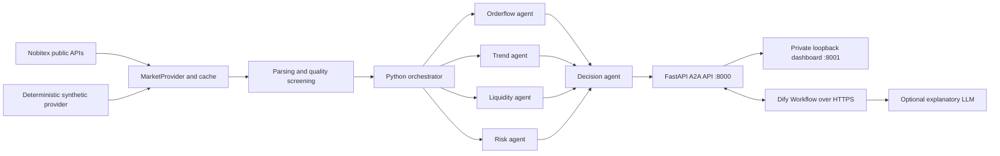

# Architecture — Nobitex A2A × Dify Market Intelligence

## 1. Purpose and safety boundary

This repository is a read-only market-intelligence research demonstration. It reads public Nobitex spot-market data in `live` mode or clearly labelled synthetic fixtures in `demo` mode. It does not connect to private exchange accounts, wallets or order endpoints. Real order execution is not implemented; `execution_enabled` is always `false`.

## 2. Logical architecture

The five agents are logical components running in one Python process. The internal calls use an ASGI HTTP transport and JSON-RPC request/response handling; they are not five separately deployed microservices.

## 3. Data flow

1. `MarketProvider` reads synthetic data in `demo` mode. In `live` mode it calls the public order-book and market-statistics endpoints.
2. The parser normalizes symbols, validates bid/ask levels, calculates spread, depth, imbalance and data age.
3. Screening rejects markets with stale/missing data, closed status, excessive spread, insufficient depth or low 24-hour turnover.
4. Eligible markets are ranked for triage; deep analysis is bounded by `MAX_DEEP` and `MAX_PARALLEL`.
5. The orchestrator calls orderflow, trend, liquidity and risk agents, then passes their outputs to the decision agent.
6. The result contains the source mode, data timestamp, screening counts, heuristic score, explanatory fields and an explicit disabled-execution flag.

## 4. Agent responsibilities

| Agent | Responsibility | Main inputs |
|---|---|---|
| Orderflow | Top-of-book depth imbalance | Bid/ask depth |
| Trend | Context from 24-hour percentage change | Market statistics |
| Liquidity | Spread and visible depth indicators | Order book |
| Risk | Illustrative quote-denominated notional cap and friction proxy | Depth, assumed fees, requested budget |
| Decision | Combines signals and emits BUY / SELL / HOLD research scenario | Four agent outputs |

`SELL` means reduce or exit an already-owned spot position. It does not mean short selling.

## 5. Scoring and interpretation

The decision score is a deterministic heuristic used to prioritize review. It combines order-flow strength, 24-hour trend strength, spread quality and signal alignment. It is **not** a calibrated probability of success, expected return, or forecast accuracy measure. The project does not include OHLC backtesting, maker/taker calibration, private balance checks, or real fill simulation.

## 6. Services and network boundaries

- **A2A API — port 8000:** FastAPI endpoints, protected scan and agent RPC routes. The `X-API-Key` header is required for protected endpoints.
- **Dashboard — port 8001:** local-only gateway. It must remain bound to loopback and must never be exposed through ngrok or a public reverse proxy.
- **Dify:** optional workflow execution. Dify Cloud must reach only the API over HTTPS. The Dify workflow stores the backend key as a Secret environment variable named `A2A_API_KEY`.
- **Local dashboard to Dify:** the local server uses `DIFY_API_KEY` (the Dify App API key) to call the published workflow. This is different from the A2A backend key.

## 7. Configuration

The local `.env` file is created from `.env.example` by the Windows/Linux bootstrap. Important settings:

- `MARKET_MODE=demo|live`
- `API_KEY`: local A2A backend secret; set a strong value.
- `PUBLIC_BASE_URL`: public HTTPS URL for the API only, when Dify Cloud needs to call it.
- `DIFY_API_KEY`: Dify Workflow App API key used by the local dashboard.
- `DIFY_API_BASE`: Dify service API base URL.
- `MARKET_TTL`, `MAX_PARALLEL`, `MAX_DEEP`: cache and concurrency controls.

## 8. A2A protocol scope

The API exposes agent cards and a limited JSON-RPC subset for `message/send` and `tasks/get`. Task state is held in a bounded in-memory registry. This release does not claim full compliance with the current A2A SDK/specification.

## 9. Known limitations

- Public market snapshots are not streaming and can become stale immediately after retrieval.
- Heuristic indicators can be manipulated and are not investment advice.
- Stop, target and size calculations are illustrative only.
- No live order placement, private account access, margin or short-selling support.
- A single-process logical-agent design is used for ease of local demonstration.
