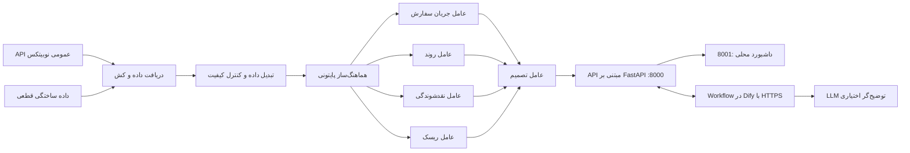

# معماری سامانه — هوشمندی بازار نوبیتکس مبتنی بر A2A و Dify

## ۱. هدف و مرز ایمنی

این مخزن یک نمونه پژوهشی و فقط‌خواندنی برای تحلیل بازار است. در حالت `demo` داده‌های ساختگیِ برچسب‌خورده تولید می‌شود و در حالت `live` فقط داده‌های عمومی بازار نوبیتکس خوانده می‌شود. اتصال به حساب خصوصی، کیف پول یا API ثبت سفارش وجود ندارد. اجرای معامله واقعی پیاده‌سازی نشده و مقدار `execution_enabled` همواره `false` است.

## ۲. نمای منطقی معماری

پنج عامل این نسخه مؤلفه‌های منطقی هستند و در یک فرایند پایتون اجرا می‌شوند؛ پنج میکروسرویس مستقل نیستند. فراخوانی داخلی از طریق انتقال ASGI و پیام‌های JSON-RPC انجام می‌شود.

## ۳. جریان داده

۱. در حالت `demo`، داده‌های ساختگی تولید می‌شود. در حالت `live`، سرویس داده عمومی دفتر سفارش و آمار بازار نوبیتکس را دریافت می‌کند.
۲. نمادها نرمال‌سازی می‌شوند و سطوح خرید/فروش، اسپرد، عمق، عدم‌تعادل و عمر داده محاسبه می‌شود.
۳. نمادهای دارای داده قدیمی یا ناقص، بازار بسته، اسپرد بالا، عمق ناکافی یا گردش ۲۴ ساعته پایین حذف می‌شوند.
۴. تحلیل عمیق فقط برای تعداد محدودی از نمادهای واجد شرایط و با محدودیت هم‌زمانی انجام می‌شود.
۵. عامل‌های جریان سفارش، روند، نقدشوندگی و ریسک اجرا شده و خروجی آن‌ها به عامل تصمیم داده می‌شود.
۶. پاسخ شامل حالت منبع داده، زمان تولید، تعداد نمادهای غربال‌شده، امتیاز ابتکاری و پرچم صریح غیرفعال بودن اجرای معامله است.

## ۴. مسئولیت عامل‌ها

| عامل | مسئولیت |
|---|---|
| Orderflow | محاسبه عدم‌تعادل عمق سفارش‌های خرید و فروش |
| Trend | استفاده از تغییرات ۲۴ ساعت گذشته |
| Liquidity | بررسی اسپرد و عمق قابل مشاهده |
| Risk | سقف فرضی اندازه موقعیت و برآورد اصطکاک معاملاتی |
| Decision | ترکیب نشانه‌ها و تولید سناریوی BUY / SELL / HOLD |

در این پروژه، `SELL` صرفاً به معنای کاهش یا خروج از دارایی اسپات موجود است؛ فروش استقراضی پشتیبانی نمی‌شود.

## ۵. تفسیر امتیاز

امتیاز تصمیم یک رتبه‌بندی ابتکاری و قطعی برای اولویت‌بندی بررسی است؛ **احتمال کالیبره‌شده موفقیت، بازده مورد انتظار یا معیار دقت پیش‌بینی نیست**. در این نسخه بک‌تست مبتنی بر OHLC، کالیبراسیون کارمزد، بررسی موجودی خصوصی یا شبیه‌سازی اجرای واقعی سفارش وجود ندارد.

## ۶. سرویس‌ها و مرز شبکه

- **API مبتنی بر A2A — پورت 8000:** مسیرهای FastAPI و عامل‌ها؛ مسیرهای محافظت‌شده به هدر `X-API-Key` نیاز دارند.
- **داشبورد — پورت 8001:** درگاه محلی و فقط loopback. این پورت نباید با ngrok یا reverse proxy عمومی شود.
- **Dify:** اجرای اختیاری Workflow. برای اتصال Dify Cloud، فقط API از طریق HTTPS در دسترس قرار می‌گیرد. کلید سمت سرور در متغیر محرمانه `A2A_API_KEY` داخل Dify نگهداری می‌شود.
- **اتصال داشبورد به Dify:** سرور محلی با `DIFY_API_KEY` (کلید App API در Dify) به Workflow منتشرشده درخواست می‌فرستد. این کلید با کلید A2A متفاوت است.

## ۷. تنظیمات

فایل محلی `.env` از روی `.env.example` ساخته می‌شود:

- `MARKET_MODE=demo|live`
- `API_KEY`: کلید محرمانه سرویس A2A محلی
- `PUBLIC_BASE_URL`: نشانی HTTPS عمومی صرفاً برای API، در صورت نیاز Dify Cloud
- `DIFY_API_KEY`: کلید API برنامه Workflow در Dify برای فراخوانی از داشبورد
- `DIFY_API_BASE`: نشانی پایه API سرویس Dify
- `MARKET_TTL`، `MAX_PARALLEL` و `MAX_DEEP`: تنظیم کش و هم‌زمانی

## ۸. محدوده پیاده‌سازی A2A

این API کارت عامل‌ها و زیرمجموعه محدودی از JSON-RPC شامل `message/send` و `tasks/get` را ارائه می‌کند. وضعیت Taskها در حافظه و به‌صورت محدود نگهداری می‌شود. این نسخه ادعای انطباق کامل با آخرین SDK یا مشخصات A2A ندارد.

## ۹. محدودیت‌های شناخته‌شده

- داده عمومی لحظه‌ای و جریانی نیست و ممکن است بلافاصله پس از دریافت قدیمی شود.
- نشانه‌های ابتکاری قابل دست‌کاری‌اند و توصیه سرمایه‌گذاری محسوب نمی‌شوند.
- حد ضرر، هدف و اندازه موقعیت صرفاً محاسبات نمونه‌اند.
- ثبت سفارش واقعی، دسترسی به حساب خصوصی، مارجین و فروش استقراضی وجود ندارد.
- برای سادگی اجرا، عامل‌ها در یک فرایند واحد قرار دارند.
